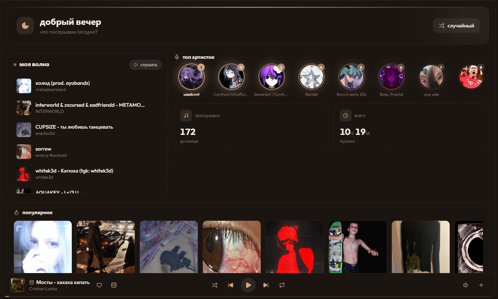
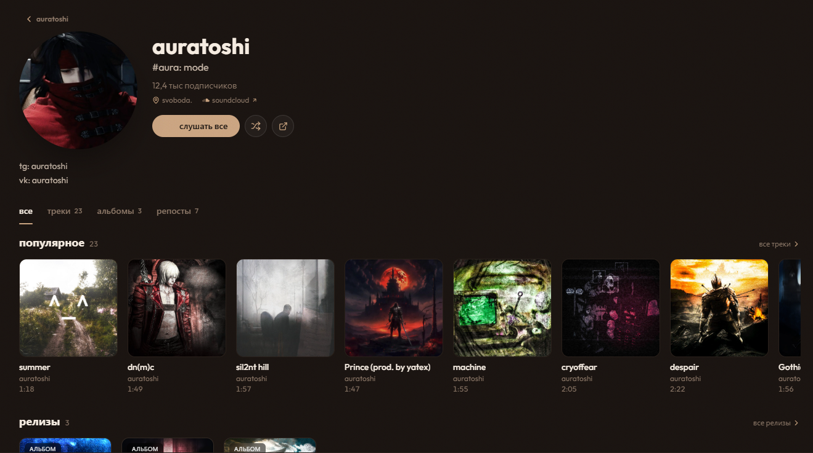
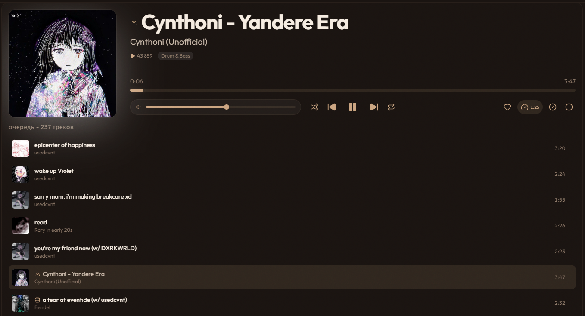

<div align="center">


<h1>aether</h1>


<b>десктопный музыкальный плеер для SoundCloud</b>

<sub>без рекламы · без капчи · без цензуры · доступно в россии</sub>

<br>
<br>

<a href="https://github.com/whyspurky/aether-react/blob/main/LICENSE">

</a>

<br>

<a href="https://t.me/aether_player">

</a>
<a href="https://github.com/whyspurky/aether-react/releases/latest">

</a>

</div>

---

<div align="center">



</div>

---

## что это

**aether** — полноценное десктопное приложение для прослушивания музыки на SoundCloud

написано на **Tauri 2** и **React 19**: rust качает метаданные и звук, react рисует интерфейс. работает нативно, без рекламы и капчи

---

## почему aether

<table>
<tr>
<td width="50%" valign="top">

### доступно в россии

SoundCloud заблокирован провайдерами — веб версия не открывается

aether работает напрямую благодаря встроенному **zapret** или **своему прокси**

### никакой рекламы

ноль баннеров, ноль промо вставок между треками, ноль всплывающих окон

чистый интерфейс | только музыка

</td>
<td width="50%" valign="top">

### нативное и лёгкое

построено на **tauri 2** на rust вместо electron

- размер установщика **3-6 мегабайт**
- RAM **200-300 мегабайт** целиком, из них rust-процесс меньше **15 мегабайт**
- мгновенный запуск
- быстрый режим для слабого железа

### стриминг в лучшем качестве

1. **AAC 160**
2. **AAC 96**
3. **MP3 HLS**
4. **MP3 Progressive**

</td>
</tr>
</table>

---

## возможности

### музыка

- поиск треков, артистов и плейлистов, история запросов
- главная: популярное и моя волна
- страница артиста: обзор, треки, альбомы, плейлисты, репосты и похожие артисты
- страницы плейлистов и альбомов, импорт плейлиста в свою библиотеку
- библиотека: избранное, история, свои плейлисты
- виртуализированные списки, длинные подборки не тормозят

### плеер

- очередь с автодогрузкой, шафл и репит
- сохранение очереди и позиции между запусками
- бесшовный переход между треками и кроссфейд с настраиваемой длиной
- скорость 0.5..2.0 без изменения тона
- отдельный питч -12..+12 полутонов, режим linked как на виниле
- нормализация громкости по rms с ограничением пика
- выбор устройства вывода звука

### звук

- 10-полосный biquad эквалайзер с преампом, пресетами и графиком АЧХ
- живой спектр текущего трека прямо в эквалайзере
- выбор качества: максимальное, высокое, среднее, низкое

### оформление

- 5 тем: amoled, neutral, midnight, coffee, aqua
- размытие обложки под интерфейсом, сила и прозрачность настраиваются
- свои пресеты темы
- плавные переходы между страницами и вкладками артиста

### офлайн и кэш

- временный кэш для мгновенного старта и переключения треков
- офлайн-сохранение трека или плейлиста целиком
- режим потока без записи на диск
- лимит кэша, размеры и очистка в настройках

### обход блокировок

- встроенный **zapret** со скачиванием одной кнопкой
- свой прокси socks5, http или https

### производительность

- вкладка быстродействие с группами флагов и тремя пресетами
- отключаются анимации, размытие панелей, шум, спектр, фоновая обложка и предзагрузка
- качество обложек 500, 300 или 200 пикселей
- частота обновления прогресса и частота сохранения состояния
- счётчик кадров для проверки после переключения

---

<table>
<tr>
<td width="50%" valign="top">



</td>
<td width="50%" valign="top">



</td>
</tr>
</table>

---

## скачать

<div align="center">

<a href="https://github.com/whyspurky/aether-react/releases/latest">

</a>

</div>

перейди на [страницу релизов](https://github.com/whyspurky/aether-react/releases/latest) и скачай

- **exe** (nsis установщик) — рекомендуется
- **msi** — альтернативный установщик

**требования** windows 10 версии 1809 или выше, windows 11

---

## обход блокировок

работает в регионах где саундклауд заблокирован

встроенный **zapret** скачивается одной кнопкой в настройках

альтернатива — свой **socks5** или **http** прокси

подробнее в [документации](./docs/public/soundcloud.md)

---

## документация

- [архитектура и гайды](./docs/public/index.md)
- [как устроен проект](./docs/public/architecture.md)
- [сборка из исходников](./docs/public/build.md)
- [changelog](./md/CHANGELOG.md)
- [roadmap](./md/ROADMAP.md)
- [известные баги](./md/BUGS.md)
- [contributing](./CONTRIBUTING.md)
- [безопасность](./SECURITY.md)

## обратная связь

| сообщество | [Telegram канал](https://t.me/aether_player) |
| :--- | :--- |
| баги | [Github issues](https://github.com/whyspurky/aether-react/issues) |
| звезда | [Github stars](https://github.com/whyspurky/aether-react/stargazers) |

pull requests приветствуются

для крупных изменений сначала открой issue

---

## сборка из исходников

<details>
<summary><b>инструкция для разработчиков</b></summary>

### требования

- node js 20+
- rust stable
- webview2 (в windows 10 и 11 уже установлен)

### запуск

```bash
git clone https://github.com/whyspurky/aether-react.git
cd aether-react
npm ci
npm run tauri:dev
```

### production сборка

```bash
npm run tauri:build
```

артефакты появятся в `src-tauri/target/release/bundle/`

### проверки

```bash
npm run check
cargo check --manifest-path src-tauri/Cargo.toml
cargo test --manifest-path src-tauri/Cargo.toml --lib audio
```

`npm run check` это строгая проверка типов, сборка фронта запускается через `npm run build`

### структура

```
src/                 react: страницы, компоненты, хуки, стор
src/lib/api/         обёртки invoke для команд rust
src-tauri/src/api/   soundcloud, http с прокси и retry, hls, качество
src-tauri/src/audio/ engine, dsp, анализатор спектра, состояние плеера
src-tauri/src/track_cache/  временный и офлайн кэш
docs/                публичные гайды и внутренние заметки
```

</details>

---

## стек

| компонент | технология |
| :--- | :--- |
| оболочка | Tauri 2 на Rust |
| фронт | React 19, Vite 8, Tailwind CSS 3.4 |
| стейт | Zustand 5 |
| роутинг | React Router 6 |
| списки | TanStack Virtual |
| drag and drop | dnd-kit |
| аудио | Rodio 0.23 на cpal |
| иконки | Lucide |
| анимации | CSS keyframes и view transitions |

---

## лицензия

MIT | подробности в файле [LICENSE](./LICENSE)

soundcloud это торговая марка soundcloud ltd | это приложение не аффилировано с soundcloud

---

<div align="center">

### дисклеймер

неофициальный клиент

не связан с soundcloud

все права на музыку принадлежат исполнителям и правообладателям

</div>

---

<p align="center">
<code>soundcloud клиент</code> · <code>soundcloud для пк</code> · <code>soundcloud windows</code> · <code>soundcloud без рекламы</code> · <code>soundcloud россия</code> · <code>soundcloud в россии</code> · <code>soundcloud не открывается</code> · <code>soundcloud заблокирован</code> · <code>soundcloud blocked russia</code> · <code>soundcloud desktop app</code> · <code>soundcloud desktop client</code> · <code>soundcloud player</code> · <code>soundcloud без капчи</code> · <code>скачать soundcloud на компьютер</code> · <code>soundcloud desktop download</code> · <code>soundcloud alternative client</code> · <code>soundcloud no ads</code> · <code>музыкальный плеер soundcloud</code> · <code>aether music player</code>
</p>

<p align="center">
<a href="https://github.com/whyspurky/aether-react/releases/latest">

</a>
</p>
